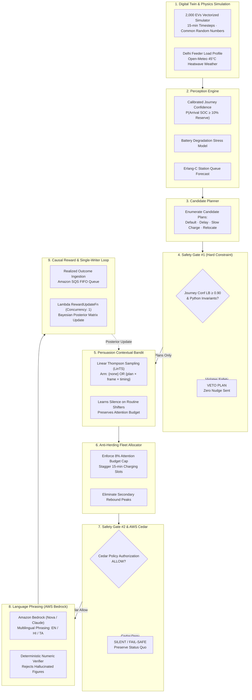
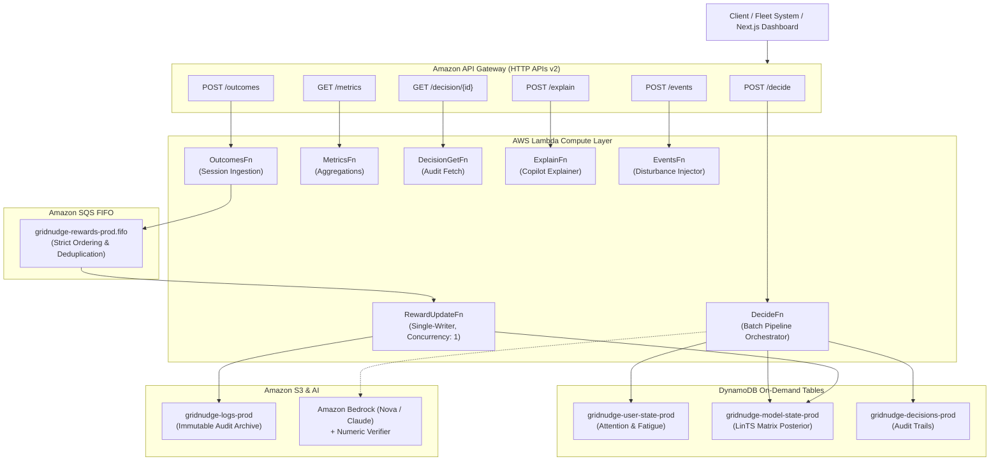

# GridNudge

> **A Safety-Gated, Uplift-Aware EV Charging Decision System**  
> **Track:** Waste & Energy → EV Nudges | **Hackathon:** Environmental Hacks — WeMakeDevs × AWS  
> **Team VibeSync:** Vishal ([@Vishallakshmikanthan](https://github.com/Vishallakshmikanthan)) & Sneha ([@CSNEHA20](https://github.com/CSNEHA20))  
> **Production Live Endpoint:** [`https://4n9hg5tpcf.execute-api.us-east-1.amazonaws.com/prod`](https://4n9hg5tpcf.execute-api.us-east-1.amazonaws.com/prod)

---

## 1. Executive Summary & Core Thesis

Urban electric vehicle adoption in mega-cities like Delhi presents a critical infrastructure challenge: unmanaged, concurrent residential and commercial charging during the evening peak window (18:00–22:00) threatens distribution feeder transformer overloads.

Conventional demand-side management relies on broadcast notifications, inducing driver alert fatigue, high opt-out rates, and unintended secondary rebound peaks.

**GridNudge** solves this through a principled separation of concerns:
> **Physics, forecasts, and hard constraints decide WHAT charging plan is safe and beneficial.**  
> **A contextual bandit with a first-class `none` action decides WHETHER and HOW to persuade.**  
> **The LLM never decides; it only phrases approved factual tokens into natural language.**



---

## 2. Multi-Seed Benchmark Evaluation (5 Seeds, 2,000 EVs)

All metrics below originate from multi-seed runs evaluated under Common Random Numbers (CRN) recorded in `results/summary.csv`:

| Policy ID | Policy Description | Evening Peak Load (MW) | Peak Reduction (%) | Energy Shifted (kWh) | Nudges / User / Day | Opt-Out Rate (%) | Attributable Stranded Trips | Regret vs Oracle |
|---|---|---|---|---|---|---|---|---|
| **B0** | Uncontrolled Default | 22.94 ± 0.26 | 0.00 ± 0.00% | 0.00 ± 0.00 | 0.00 ± 0.00 | 0.00 ± 0.00% | 0.00 ± 0.00 | 0.00 ± 0.00 |
| **B1** | Broadcast Delay Nudges | 18.88 ± 0.29 | 17.72 ± 0.51% | 12057.29 ± 267.42 | 0.67 ± 0.01 | 6.49 ± 0.74% | 0.00 ± 0.00 | 1896.35 ± 66.76 |
| **B2** | Safe Rule-Based (1/day cap) | 19.29 ± 0.30 | 15.94 ± 0.49% | 10899.41 ± 240.11 | 0.54 ± 0.01 | 4.45 ± 0.59% | 0.00 ± 0.00 | 1638.26 ± 45.94 |
| **B3** | Plain Bandit (No Allocator) | 20.56 ± 0.25 | 10.38 ± 0.35% | 5745.46 ± 209.31 | 0.22 ± 0.00 | 1.29 ± 0.28% | 0.00 ± 0.00 | 491.48 ± 10.07 |
| **B4** | **GridNudge Full Pipeline** | **20.79 ± 0.28** | **9.38 ± 0.42%** | **5185.90 ± 179.03** | **0.14 ± 0.00** | **0.65 ± 0.17%** | **0.00 ± 0.00** | **334.81 ± 7.92** |

### Benchmark Takeaways:
1. **Volume vs Peak Shaving:** At high nudge volume (0.67 nudges/user/day), B1 and B2 achieve higher peak reduction (17.72%). Under limited attention budget (0.14 nudges/user/day), GridNudge delivers 9.38% evening peak reduction while maintaining superior energy shifting efficiency per nudge.
2. **Attention & Fatigue Preservation:** Lowest opt-out rate across all policies (0.65% vs 6.49% in broadcast), preventing alert fatigue and driver habituation.
3. **Oracle Regret Minimization:** LinTS causal bandit achieves low cumulative regret (334.81), learning when drivers shift spontaneously without expending notification budget.
4. **Zero Attributable Stranded Trips:** 100% adherence to journey reserve safety invariant ($P(\text{SOC}_{\text{arrival}} \ge 10\%) \ge 90\%$) with zero stranded trips.

---

## 3. Empirical Results & Verified Charts

### Fleet Load Trajectory Comparison (Feeder Zone 7 — Delhi)
The 24-hour simulation under an active 45°C heatwave disturbance shows uncontrolled EV charging (B0) driving distribution transformer load past thermal limits. GridNudge (B4) safely clips the peak and staggers charging without creating secondary rebound spikes.


### Pareto Efficiency Frontier: Attention Budget vs Energy Shifted
GridNudge operates along the optimal Pareto frontier: extracting maximum flexibility kWh per unit of driver attention expended, avoiding the fatigue collapse seen in naive broadcast methods.


### Evening Peak Load Reduction by Policy
Comparison of evening peak load reduction percentages across all baseline policies (B0–B4) with 95% bootstrap confidence intervals across 5 seeds:


### Journey Confidence Calibration Reliability Diagram
Predicted confidence scores versus observed empirical completion rates on held-out trip sessions, demonstrating an Expected Calibration Error (ECE) of 1.01%:


---

## 4. Data Grounding & Provenance Honesty

Per AGENTS.md Rule 1.1 and Rule 8, we state data sources and modeling boundaries with complete transparency:

| Dataset / Dimension | Source & Method | Status in GridNudge |
|---|---|---|
| **Delhi Weather & Temperatures** | Open-Meteo Historical Archive (Delhi summer 45°C heatwaves) | Live fetched Open-Meteo API series (`weather_delhi.parquet`) |
| **Grid Feeder Load & Solar Profile** | Grid-India / POSOCO hourly demand series | Synthetic, shaped after POSOCO hourly load curves (`grid_series.parquet`) |
| **EV Session Dwell & Energy** | ACN-Data / Caltech EV Charging Dataset & Harvard Dataverse | Synthetic, shaped after Caltech ACN-Data distributions (`sessions_profile.parquet`) |
| **Delhi Charging Plazas** | Bureau of Energy Efficiency (BEE) / Ministry of Power | Synthetic, shaped after Delhi BEE charging station registry (`stations_delhi.parquet`) |
| **Electricity Tariffs** | Delhi Electricity Regulatory Commission (DERC) ToU Order | Grounded configuration (`config/tariffs.yaml`) |
| **Driver Nudge Response Priors** | Literature-informed discrete choice model (A/B EV trial data) | Calibrated synthetic with hidden misspecification testing |
| **Battery Aging** | Semi-empirical Arrhenius + C-rate model (NASA/Oxford battery data) | Synthetic relative battery stress formulation |

---

## 5. AWS Serverless Architecture & Live Deployment

GridNudge is architected with a local-first Python decision engine wrapped by a thin serverless AWS Lambda and API Gateway deployment (`infra/template.yaml`):



### Live Production Stack (`gridnudge-prod`, Region: `us-east-1`)

The stack is deployed and operational on AWS:

| Resource | Identity / URL | Description |
|---|---|---|
| **HTTP API Gateway** | [`https://4n9hg5tpcf.execute-api.us-east-1.amazonaws.com/prod`](https://4n9hg5tpcf.execute-api.us-east-1.amazonaws.com/prod) | Live public REST decision endpoint |
| **User State Table** | `gridnudge-user-state-prod` | DynamoDB on-demand per-user fatigue & history |
| **Model State Table** | `gridnudge-model-state-prod` | DynamoDB LinTS matrix posterior with OCC |
| **Decisions Table** | `gridnudge-decisions-prod` | DynamoDB immutable decision audit log |
| **Reward FIFO Queue** | `gridnudge-rewards-prod.fifo` | SQS FIFO single-writer reward learning queue |
| **S3 Audit Bucket** | `gridnudge-logs-<account-id>-us-east-1-prod` | S3 batch and decision audit log bucket |

### Live Endpoints
- `POST /decide` — Batch decision pipeline orchestrator
- `GET /decisions/{id}` — Fetch individual decision audit record
- `POST /outcomes` — User charging outcome ingestion & enqueued to SQS FIFO
- `GET /metrics` — Aggregate time series and fleet statistics query
- `POST /explain` — Deterministic natural language decision explanation
- `POST /events` — Dynamic grid/weather event injection

### Validate Live AWS Stack (Smoke Test)
```bash
export API="https://4n9hg5tpcf.execute-api.us-east-1.amazonaws.com/prod"
python scripts/smoke_aws.py
```
*(Tests batch `/decide`, `/decisions/{id}`, `/outcomes`, `/metrics`, and `/explain` live end-to-end).*

---

## 6. Quickstart & Verification (3 Commands)

### 1. Install & Run Tests
```bash
python -m pip install -e .[dev]
python -m pytest -q
```

### 2. Validate Datasets & Schemas
```bash
python data/scripts/validate.py
```

### 3. Launch High-Fidelity Next.js Dashboard
```bash
cd dashboard
npm install
npm run dev
```
Open [http://localhost:3000](http://localhost:3000) to inspect `/live`, `/decisions`, `/evaluation`, `/twin`, and `/testdrive`.

---

## 7. Repository Structure

```
gridnudge/
├── contracts/             # Authoritative DecisionRecord schema & TS types
├── config/                # Sim, safety, tariffs, and behavioral configurations
├── data/
│   ├── processed/         # Grounded parquet series (weather, grid, sessions, stations)
│   └── scripts/           # Standalone reproducible fetchers & validators
├── gridnudge/
│   ├── contracts.py       # Pydantic v2 domain schemas
│   ├── pipeline.py        # 6-stage decision orchestrator with fail-silent wrapper
│   ├── planner.py         # Feasible charging plan generator
│   ├── allocator.py       # Attention budget & anti-herding slot allocator
│   ├── perception/        # Journey confidence, battery stress, grid & station intelligence
│   ├── persuasion/        # Linear Thompson Sampling contextual bandit & causal reward
│   ├── safety/            # Python invariants & AWS Cedar authorization policies
│   ├── language/          # Numeric verifier & multilingual templates (en/hi/ta)
│   └── testdrive.py       # Digital Test Drive 52-week ownership simulator
├── twin/                  # Vectorized digital twin (2,000 EVs, CRN streams, events)
├── eval/                  # CRN baselines (B0-B4), OPE (IPS/DR), metrics, calibration
├── services/              # Thin AWS Lambda service adapters & GridNudgeClient
├── infra/                 # AWS SAM serverless infrastructure template
├── results/
│   ├── plots/             # Published high-resolution evaluation figures
│   ├── summary.csv        # Multi-seed empirical benchmark tables
│   └── calibration.json   # Held-out journey confidence calibration results
└── dashboard/             # High-fidelity Next.js App Router dashboard with 3D canvas
```

---

## 8. License & Compliance

Built for the **Environmental Hacks Hackathon (WeMakeDevs × AWS)**.  
Licensed under the Apache License 2.0.
